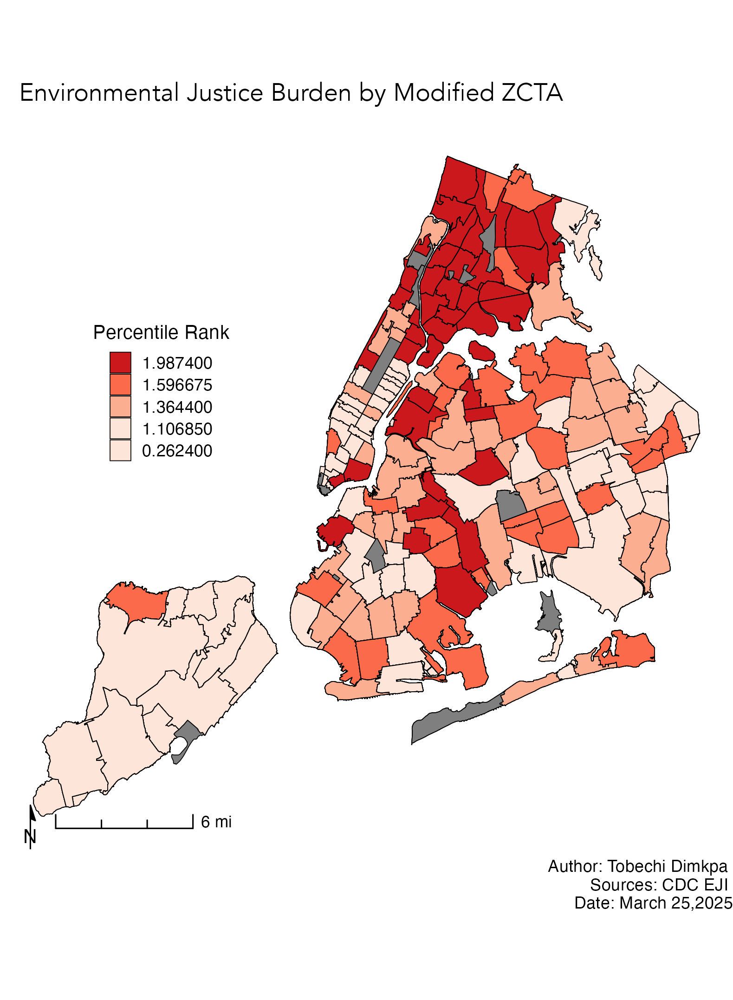
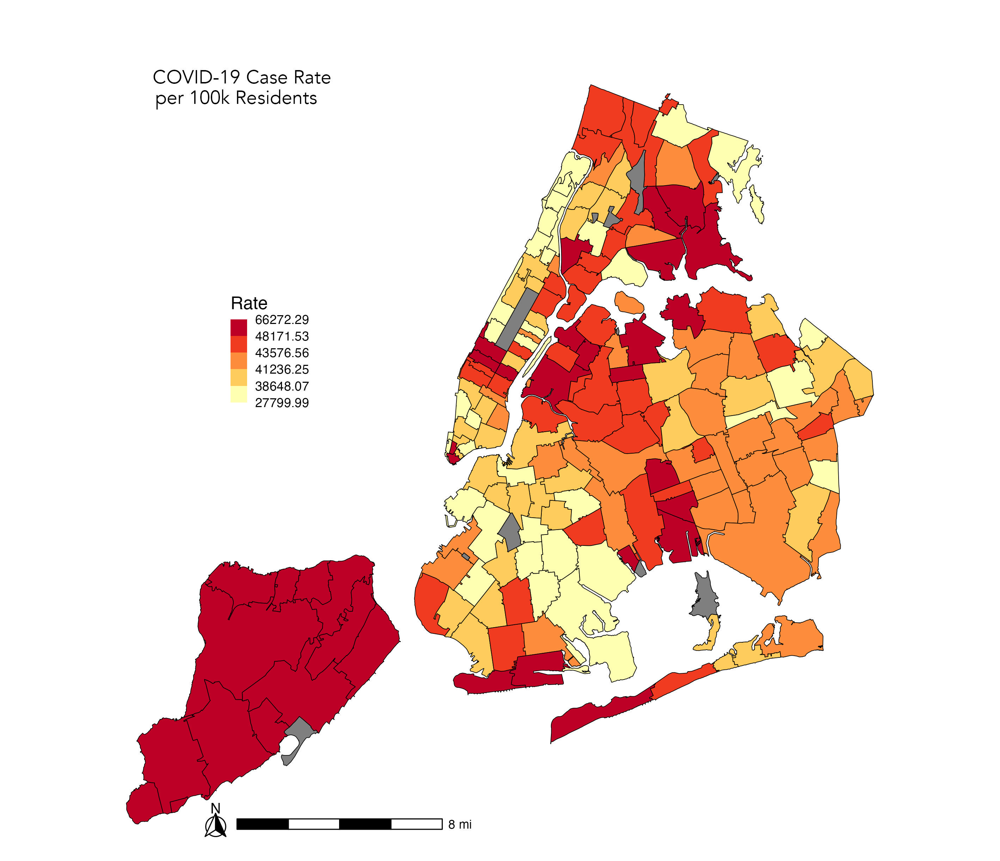
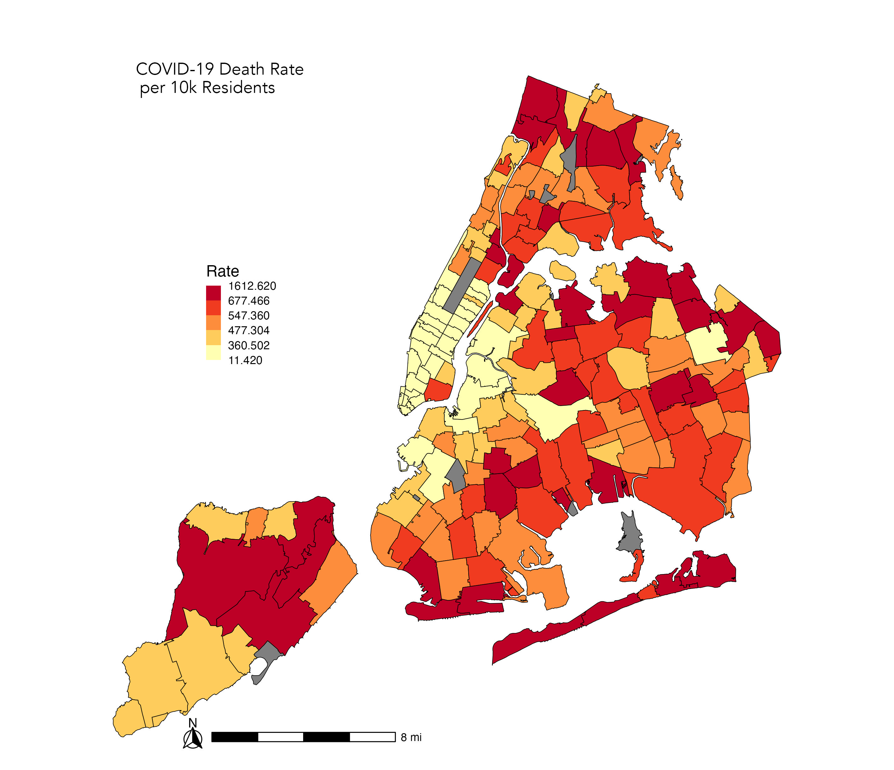
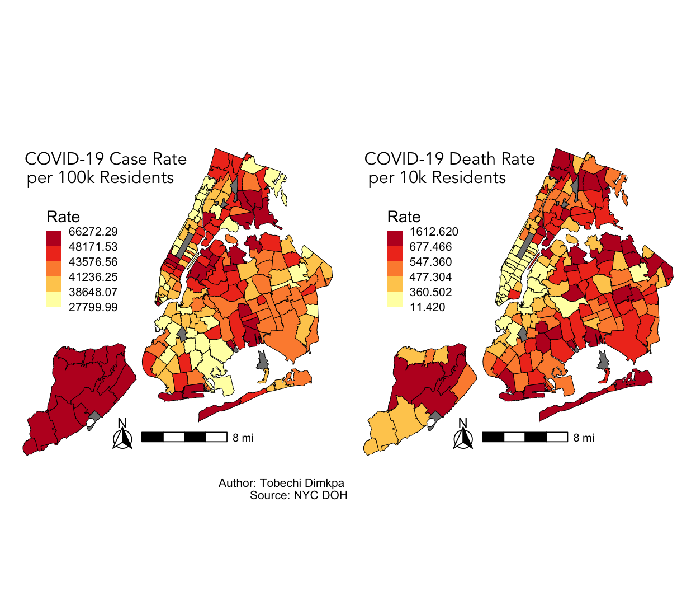
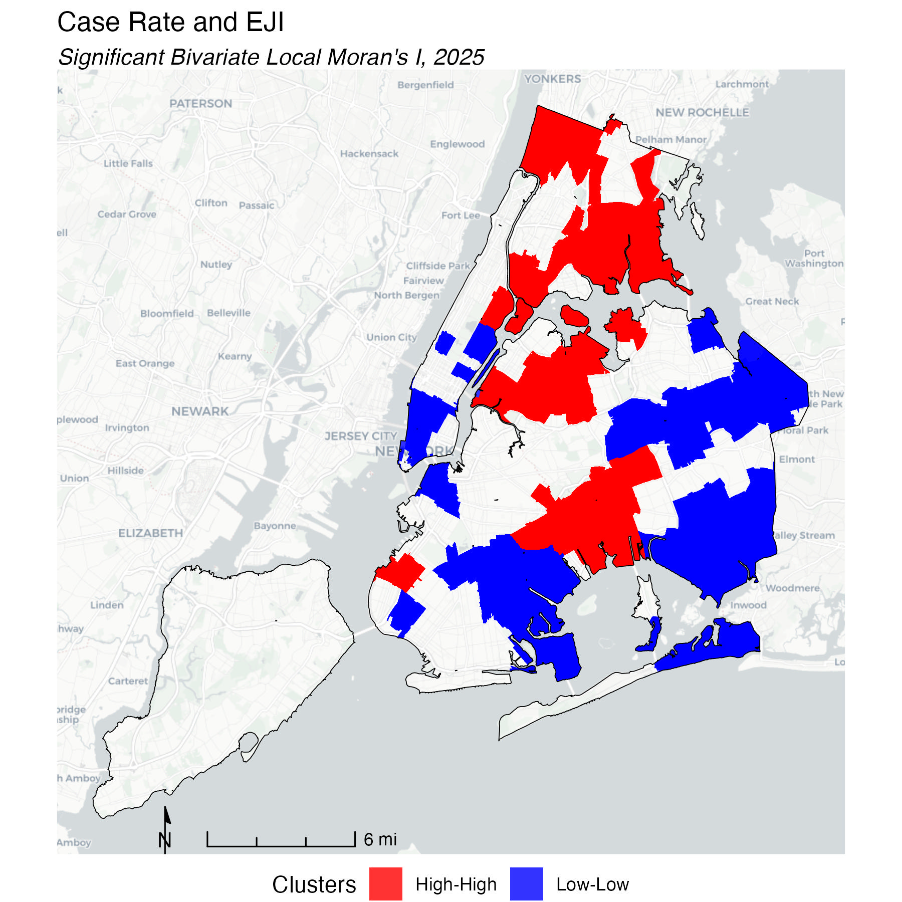
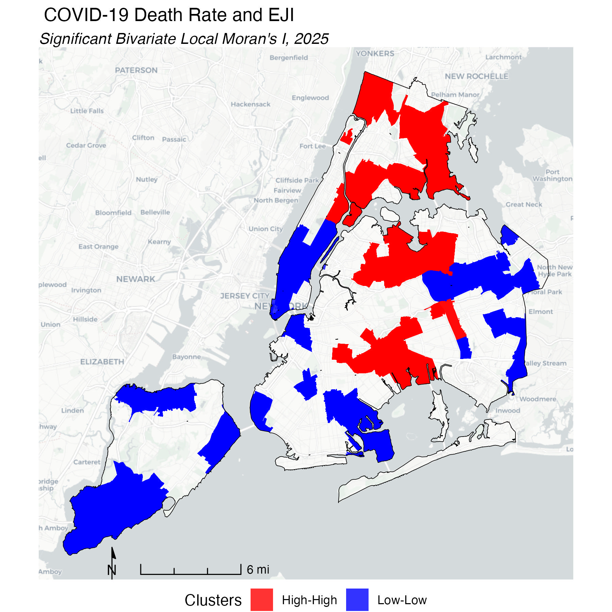
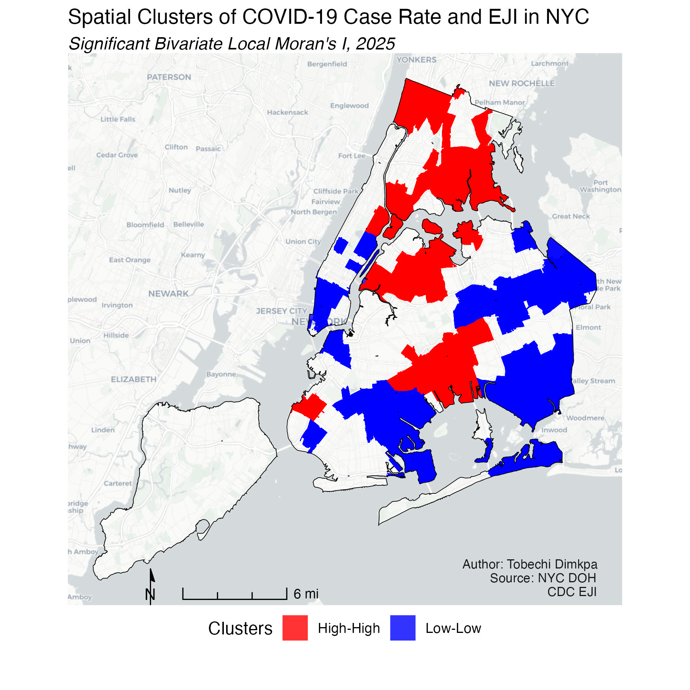
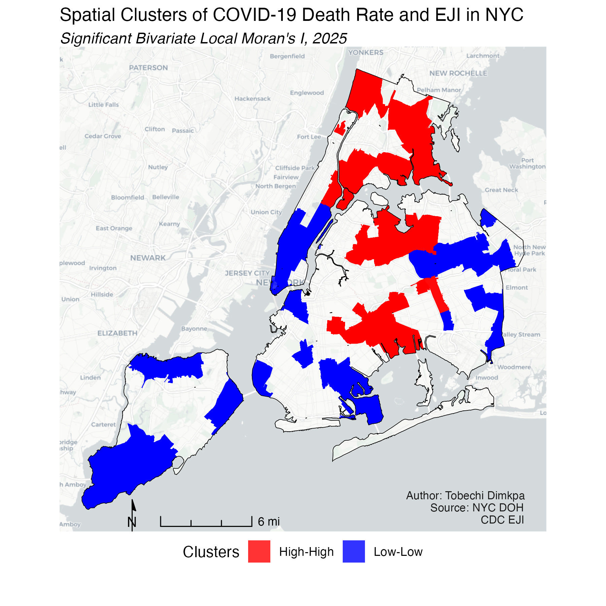
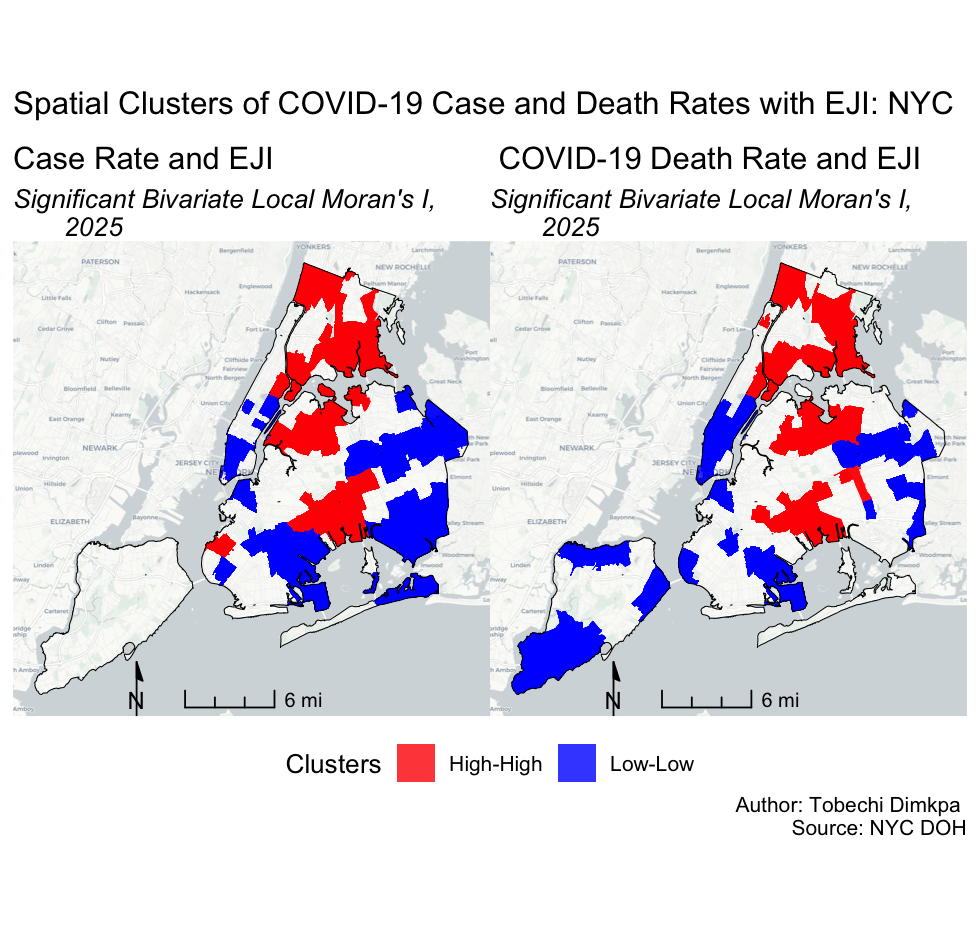

# NYC COVID-19 and Environmental Justice — Spatial Analysis by MODZCTA

How do COVID-19 case and death rates vary across New York City's Modified ZIP Code Tabulation Areas (MODZCTAs) in relation to environmental justice burden, as measured by the CDC Environmental Justice Index (EJI)?

This project maps COVID-19 case rates, death rates, and EJI percentile ranks across NYC's five boroughs, then tests whether the two are spatially associated — with Pearson correlation and bivariate Local Moran's I (LISA) cluster analysis.

## Research question

Are areas with higher environmental justice burden also the areas with higher COVID-19 case and death rates — and where do statistically significant clusters of high burden *and* high COVID-19 rates occur?

## Data

| Dataset | File(s) in this repo | Source, as credited in the analysis |
|---|---|---|
| CDC Environmental Justice Index, tract level, filtered to Bronx, Kings, New York, Queens, and Richmond counties | Excluded (large source file — see below) | CDC EJI |
| COVID-19 cases and deaths by MODZCTA (counts, rates, neighbourhood, borough) | `data/data-by-modzcta.csv` (177 MODZCTAs) | NYC DOH |
| Monthly COVID-19 hospitalization rates by MODZCTA, from March 2020 | `data/hosprate-by-modzcta.csv` | NYC DOH |
| MODZCTA-to-census-tract crosswalk | `data/modzcta_to_census_tract.csv` | Derived in the analysis (see `analysis.R`) |
| ZCTA–census tract relationship file, filtered to New York State | Excluded (large source file — see below) | U.S. Census Bureau relationship file |
| MODZCTA boundary polygons and census tract boundaries | Excluded (large source files — see below) | NYC MODZCTA boundaries; Census Bureau TIGER/Line tract shapefile |

No source URLs are listed here: obtain each file from its publishing agency's data portal under the names above.

## Methods

1. **EJI to MODZCTA.** Tract-level EJI records are joined to ZIP Code Tabulation Areas through the ZCTA–tract relationship file, weighted by tract population (`spl_ser × e_totpop` in the script), and joined to MODZCTA boundary polygons.
2. **Choropleth maps.** EJI percentile rank, COVID-19 case rate (per 100k residents), and COVID-19 death rate (per 10k residents) are mapped by MODZCTA using quantile breaks (4 classes for EJI, 5 for the COVID-19 rates).
3. **Correlation.** Pearson correlation between EJI percentile rank (`spl_ser`) and COVID-19 case and death rates.
4. **Spatial association.** A spatial lag of EJI is computed from the 45 nearest neighbours with row-standardised weights. Global and local bivariate Moran's I are calculated (999 permutations), and significant clusters (p < 0.05) are classified High-High, Low-Low, High-Low, and Low-High. A univariate Moran's I test for EJI is also run.

## Findings

- **EJI vs. case rate — essentially no linear association.** Pearson correlation between EJI percentile rank and COVID-19 case rate: **r = −0.037, p = 0.052, 95% CI −0.074 to 0.0003**. The association is weak and not statistically significant at the 0.05 level. Note that this test, as recorded in the script, was run on the joined crosswalk-level table (df = 2764), not on MODZCTA-level aggregates, so it should not be read as a MODZCTA-level correlation.
- **EJI vs. death rate.** A Pearson test is run in the script, but no result value is recorded in it, so no figure is reported here.
- **Bivariate clusters.** The bivariate LISA maps identify statistically significant High-High clusters — areas where high COVID-19 rates coincide with high lagged EJI — shown in red, and Low-Low clusters, shown in blue (p < 0.05, 999 permutations). See `maps/bi_cluster_caserate.jpg` and `maps/bi_cluster_deathrate.jpg`.
- **Moran's I.** Global bivariate Moran's I and a univariate Moran's I for EJI are computed in the script, but no numeric results are recorded in it, so no values are reported here.

## Maps

### Environmental Justice Index by MODZCTA



### COVID-19 case rate per 100k residents



### COVID-19 death rate per 10k residents



### Case and death rates side by side



### Bivariate LISA clusters — case rate and EJI



### Bivariate LISA clusters — death rate and EJI



### Cluster maps — case rate



### Cluster maps — death rate



### Bivariate clusters, combined



## Tools

- **R** — all analysis and mapping in `analysis.R`
- **QGIS** — spatial data preparation and mapping
- **R packages:** tidycensus, tidyverse, sf, RColorBrewer, classInt, ggspatial, sfhotspot, patchwork, osrm, biscale, sfdep, janitor

## Files

```
nyc-covid-eji-vulnerability/
├── README.md
├── analysis.R                      # Full analysis: EJI join, choropleths, correlation, bivariate LISA
├── maps/
│   ├── eji_map.jpg                 # EJI percentile rank by MODZCTA
│   ├── covid_case_rate.jpg         # COVID-19 case rate per 100k by MODZCTA
│   ├── covid_death_rate.jpg        # COVID-19 death rate per 10k by MODZCTA
│   ├── covid_case_death_rate.png   # Case and death rates side by side
│   ├── og_cluster_caserate.jpg     # Cluster map — case rate
│   ├── og_cluster_deathrate.jpg    # Cluster map — death rate
│   ├── bi_cluster_caserate.jpg     # Significant bivariate LISA clusters — case rate × EJI
│   ├── bi_cluster_deathrate.jpg    # Significant bivariate LISA clusters — death rate × EJI
│   └── bivariate_clusters.png      # Bivariate clusters, combined view
└── data/
    ├── data-by-modzcta.csv             # COVID-19 cases/deaths by MODZCTA (177 rows)
    ├── hosprate-by-modzcta.csv         # Monthly hospitalization rates by MODZCTA, from Mar 2020
    └── modzcta_to_census_tract.csv     # MODZCTA-to-census-tract crosswalk
```

## Reproducibility

- Run `analysis.R` from the repository root — all paths in the script are relative.
- Install the packages listed under Tools first; the script does not install packages itself.
- **Large source files are not included in this repo.** To reproduce the analysis from scratch, obtain the following from their publishing agencies (see Data above) and place them in the repo root:
  - `New York.csv` — CDC EJI tract-level file for New York (~3.7 MB)
  - `zcta_tract_rel_10.txt` — ZCTA–census tract relationship file (~23 MB)
  - `modzcta_2010.shp` (+ `.dbf`, `.shx`, `.prj`) — MODZCTA boundaries
  - `tract/tl_2024_36_tract.shp` — Census Bureau TIGER/Line tract shapefile for New York State
  - `covid_eji.csv` (~37.6 MB) and `eji.dbf` / `eji.shp` (~8.7 MB) — intermediate EJI extracts; not required if you re-run the join from the source files above
- The staged script's `ggsave()` calls reproduce `maps/eji_map.jpg`, `maps/covid_case_rate.jpg`, `maps/covid_death_rate.jpg`, `maps/bi_cluster_caserate.jpg`, and `maps/bi_cluster_deathrate.jpg`. The remaining figures in `maps/` (`og_cluster_caserate.jpg`, `og_cluster_deathrate.jpg`, `bivariate_clusters.png`, `covid_case_death_rate.png`) are exported figures included as-is.
- Map tiles in the cluster maps use a Carto basemap (`annotation_map_tile(type = "cartolight")`), so an internet connection is needed to re-render those maps.

## Author

Tobechi Dimkpa
